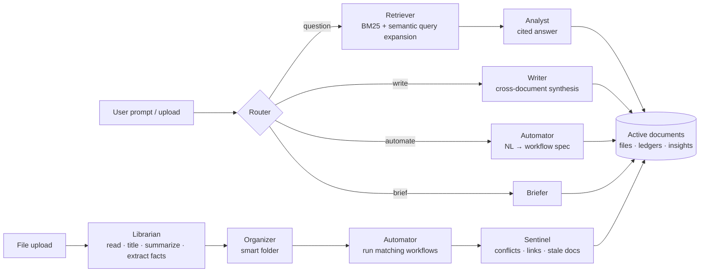

# Cortex — Brainstorming & Agentic User Flows

*Submission artifact for the "Agentic Drive" hackathon: the thinking we did before writing code.*

---

## 1. Reframing the problem

Google Drive and Dropbox treat a file as a **sealed box**: it only matters when a human opens it. We decided the real problem isn't storage or search. It's that **nobody is reading the drive**. Teams pile up meeting notes, budgets, invoices and contracts that contradict each other, go stale, and hide decisions. Today, people do all of that reading by hand.

> **Our thesis:** A drive should behave like a diligent colleague who has read every file, remembers what changed, notices when two documents disagree, and does the paperwork when a new file arrives.

We used three lenses to stretch the idea:

| Lens | Passive drive today | What an *active* drive does |
|---|---|---|
| **Memory** | Remembers bytes | Remembers *facts*: figures, dates, decisions and who said them |
| **Attention** | Waits for a search | Reacts the moment a file lands: files it, links it, checks it |
| **Agency** | Never writes anything | Writes new documents, keeps ledgers, refreshes stale docs |

## 2. Who we designed for

- **Priya, marketing lead.** Lives in meeting transcripts. Needs "what did we actually decide?" without rereading eight calls.
- **Dana, ops & finance.** Drowns in invoices and contracts. Needs numbers extracted, logged and reconciled automatically.
- **Leo, product.** Joins mid-project. Needs a briefing on the state of things, not a folder tree.

## 3. Idea storm (everything we considered)

We generated ideas freely first, then scored them. ★ = built in the prototype.

**Organization**
- ★ Self-organizing *smart folders*: the agent names and creates folders from content, never the user
- ★ Auto-titles, summaries, tags, people & organizations for every file
- ★ One-click "Reorganize": the agent redesigns the whole folder structure
- Time-travel view: "show me the drive as it looked before the launch moved"

**Retrieval**
- ★ Ask the drive in plain language, with answers that **cite the exact passage**
- ★ Recency-aware answers: newer documents supersede older ones
- ★ Answers warn you when sources disagree ("Heads-up: the budget sheet still says $45,000")
- Voice queries from mobile

**Cross-document intelligence (our "aha" layer)**
- ★ **Conflict detection (Sentinel agent):** the same figure stated differently across files is surfaced the moment the second file arrives
- ★ **Living documents:** generated docs remember their sources and flag themselves *stale* when new related information lands, with one-click refresh
- ★ Cross-project connections ("this lease relates to the relocation plan")
- Duplicate detection (★ basic), "gap" detection (a doc references an attachment that isn't in the drive)
- Decision log: every decision across all meetings, timelined

**Synthesis**
- ★ Select N files → "draft a PRD from these" → new document saved into the drive
- ★ Router agent picks the sources itself when you don't ("draft a doc from the Aurora meetings")
- ★ Drive briefing: a status report of every project, open conflicts, ledgers
- Auto-generated weekly digest email

**Automation**
- ★ Trigger workflows: *invoice arrives → extract total, vendor, category → append to Expense Ledger.csv*
- ★ *Meeting notes arrive → action items + owners + due dates → Action Items tracker*
- ★ **Natural-language workflow builder:** "When a contract is uploaded, extract the landlord, monthly rent… into Contracts.csv", which also **backfills** existing files
- Approval flows (route a contract to legal), calendar reminders for extracted deadlines

### Scoring (impact × feasibility in a hackathon)

| Idea | User impact | "Aha" factor | Feasibility | Decision |
|---|:-:|:-:|:-:|---|
| Cited Q&A | High | Med | High | Build |
| Smart folders | High | Med | High | Build |
| Conflict detection | **Very high** | **Very high** | Med | Build (signature feature) |
| Living / stale documents | High | High | Med | Build |
| Cross-doc synthesis | High | High | High | Build |
| NL workflow builder + backfill | High | High | Med | Build |
| Time-travel view | Med | High | Low | Later |
| Approval flows | Med | Low | Med | Later |

## 4. Architecture: the intelligent middleware

Users never touch the file system directly. Every request goes to a team of narrow agents that orchestrate it:

**Why many small agents instead of one big prompt?** Each agent has one job, a strict JSON schema, and a visible trace. Users can *see* the Librarian read, the Organizer file, and the Sentinel catch a conflict, which builds trust. Each agent also has a deterministic offline fallback, so the product never breaks.

## 5. Agentic user flows (designed before coding)

### Flow A: "The drive caught a mistake"
1. Dana uploads the signed **lease**.
2. Librarian: *contract, Harborview Properties, Monthly Base Rent $15,200*.
3. Organizer files it into **Office Relocation** (content similarity).
4. Sentinel compares it with the relocation plan: **⚠ plan budgets $14,500/month but the lease says $15,200**, and marks the lease as the newer source.
5. The conflict shows on the dashboard before anyone builds a budget on the wrong number.

### Flow B: "Paperwork that does itself"
1. An invoice from EventSpace Co lands in the drive.
2. The *Invoice → Expense Ledger* workflow fires: date, vendor, invoice #, category (**Events**), total ($12,300).
3. A row is appended to **Expense Ledger.csv**, an auto-maintained file that is itself searchable ("how much have we spent on invoices?").

### Flow C: "Write me the doc"
1. Priya types *"Draft a launch requirements doc from the Aurora meetings"* without selecting anything.
2. Router classifies it as a writing task and **picks the three meeting transcripts itself**.
3. Writer reconciles them: latest figures win, discrepancies are listed, action items are tabled, and open questions are kept.
4. The result is saved as a **living document** linked to its sources.
5. Later, customer interview notes arrive. The Sentinel flags the doc **↻ stale**, and one click regenerates v2 with the new insights.

### Flow D: "Teach the drive a new habit"
1. *"When a contract is uploaded, extract the landlord, monthly rent, start date and renewal terms into Contracts.csv."*
2. Automator converts the sentence into a workflow spec (trigger, columns, output file).
3. It **backfills** existing contracts immediately, then runs on every future one.

### Flow E: "Catch me up"
*"Brief me on my drive"* returns a per-project status, the conflicts that need attention, and the live ledgers in one page.

## 6. UX principles

- **One command bar.** Ask, write, automate and brief all go through the same input; the Router figures out intent.
- **Show the work.** Every result carries an agent trace (who did what, how long it took).
- **Citations over confidence.** Answers link to the exact passage; conflicts are shown with each value, its source and its date.
- **Zero filing.** No "New folder" button exists, on purpose.
- **Graceful degradation.** No API key? The same agents run offline heuristics, and the trace says so.

## 7. Mapping to the judging criteria

| Criterion | How Cortex answers it |
|---|---|
| Conceptual vision | Storage reframed as a colleague who reads, remembers, notices and acts (memory, attention, agency) |
| Innovation | Sentinel conflict detection, self-flagging living documents, NL workflows with backfill |
| Technical execution | Claude Opus 5.5 with structured outputs per agent, hybrid BM25 + LLM query-expansion retrieval, citations, serialized ingest pipeline, deterministic offline fallbacks |
| User experience | Drive-like UI, single command bar, drag-and-drop, visible agent traces, conflict tables with "newest" highlighting |
