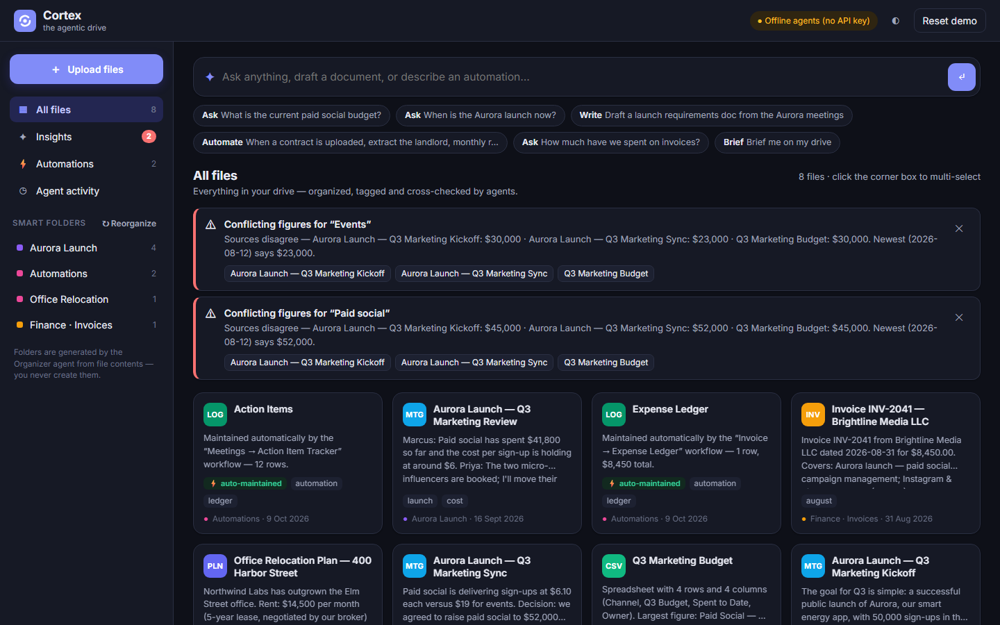

# Cortex — the agentic drive

An "advanced Google Drive" where files aren't just stored: a team of AI agents **reads every file, organizes it, cross-checks it against everything else, answers questions with citations, writes new documents, and runs automations** the moment files arrive.



**Project page:** https://ranet5-design.github.io/cortex-agentic-drive/ · **Submission PDF:** [submission/Cortex_Lab05_Hackathon_Submission.pdf](submission/Cortex_Lab05_Hackathon_Submission.pdf)

Built for the *Agentic Drive* hackathon. See [BRAINSTORM.md](BRAINSTORM.md) for the brainstorming and user flows, and [PITCH_SCRIPT.md](PITCH_SCRIPT.md) for the 3-minute demo script.

## Features

| Capability | What it does |
|---|---|
| **Proactive organization** | The Librarian titles, summarizes, classifies and tags each upload and extracts people, organizations and key figures. The Organizer files it into a smart folder it names itself. "Reorganize" rebuilds the whole structure. |
| **Semantic retrieval** | Ask in plain English. Hybrid retrieval (BM25 over passages + LLM query expansion) feeds the Analyst, which answers with clickable citations, weights newer sources, and warns about conflicting figures. |
| **Cross-document synthesis** | Select files (or let the Router pick them) and say "draft a PRD from these". The Writer reconciles sources and saves a **living document** that flags itself **stale** when related files arrive; one click regenerates it. |
| **Automated workflows** | Built in: *Invoice → Expense Ledger* and *Meetings → Action Item Tracker*. Write new rules in plain English ("When a contract is uploaded, extract … into Contracts.csv"); they **backfill** existing files. |
| **Sentinel insights** | Every new file is cross-checked: conflicting figures (with the newest source highlighted), stale documents, duplicates and cross-project connections. |
| **Drive briefing** | "Brief me" produces a status report of every project, open conflicts and live ledgers. |
| **Transparent agents** | Every result shows the agent trace: who did what, in what order, how long it took. |

## Run it

Requires Node.js 18+.

```bash
npm install
```

```bash
npm start
```

Open http://localhost:3000. On first run the drive is seeded with a demo company (Northwind Labs: an "Aurora" product launch and an office relocation). Drag the files from `demo-uploads/` onto the page to watch the agents work live. `npm run reset` wipes and re-seeds.

### Powering the agents with Claude

Set an Anthropic API key before starting and every agent runs on **Claude Opus 5.5** (`claude-opus-5-5`):

```bash
ANTHROPIC_API_KEY=sk-ant-... npm start
```

On Windows PowerShell: `$env:ANTHROPIC_API_KEY="sk-ant-..."; npm start`.

To check the connection before a demo, run `npm run check-ai` with the key set.

Without a key, the same agents run **offline heuristics** (TF-IDF clustering, extractive answers, regex extraction), so the prototype always works. The header pill shows which mode is active. Set `AGENT_MODE=offline` to force offline mode, or `CLAUDE_MODEL` to use a different model.

## Architecture

```
public/            Vanilla JS single-page UI (no build step)
server.js          Zero-framework Node HTTP server + JSON API
lib/agents.js      The agent team: Router, Librarian, Organizer, Automator, Sentinel,
                   Retriever, Analyst, Writer, Briefer — each with a Claude path and an offline path
lib/llm.js         Claude wrapper (Anthropic SDK, structured JSON outputs, streaming for long writes,
                   server-side refusal fallback)
lib/text.js        Chunking, BM25 index, TF-IDF vectors, money/fact extraction
lib/store.js       JSON-file persistence (data/db.json + data/files/)
seed/              Demo drive loaded on first run
demo-uploads/      Files to drag in during the demo
```

**Ingest pipeline** (serialized per file): Librarian → Organizer → re-index → Automator (matching workflows) → Sentinel (conflicts, links, stale living docs).

**Claude usage.** Structured calls use `output_config.format` JSON schemas, so every agent returns validated JSON. Long-form writing (answers, documents, briefings) is streamed. Requests opt into `fallbacks: "default"`, so a declined request is retried server-side on a fallback model. If a call fails (no network, bad key), that step falls back to the offline implementation and the trace records it.

### API

| Method | Path | Body |
|---|---|---|
| GET | `/api/state` | — |
| GET | `/api/file?id=` | — |
| POST | `/api/upload` | `{ name, data /* base64 */ }` |
| POST | `/api/command` | `{ text, selected: [fileIds] }`, routed by the Router agent |
| POST | `/api/ask` · `/api/synthesize` · `/api/brief` · `/api/reorganize` | direct agent calls |
| POST | `/api/workflows` | `{ text }`: natural-language rule |
| POST | `/api/refresh` | `{ fileId, addSources }`: regenerate a living document |

Supported uploads: PDF, TXT, MD, CSV, JSON, HTML (text-based PDFs; scanned PDFs need OCR).
